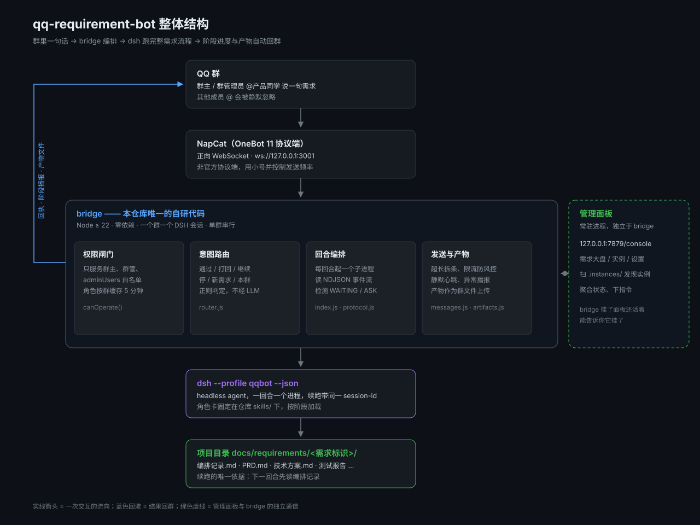

# qq-requirement-bot


把 `requirement-spec` skill 接到 QQ 群：在群里 @产品同学 说一句需求，它按「产品需求 → 设计 → 技术方案 → 开发 → 代码评审 → 测试 → 验收」全流程自动跑，各阶段进度和产物自动同步回群里。

```
你    @产品同学  Instanto 首页加个欢迎弹窗，手动批准
产品同学  收到，开始处理。
         需要澄清 3 点：1. 弹窗出现时机？2. 是否记住关闭状态？3. 文案定稿了吗？
         等你回复：需求澄清
你    @产品同学  1. 首次启动 2. 记住 3. 用这句「欢迎回来」
产品同学  需求卡片和 PRD 已出，路径 docs/requirements/welcome-modal/PRD.md
         [群文件] welcome-modal__PRD.md
         等你回复：PRD 确认
```

## 它怎么工作



bridge 是唯一的自研代码，只做四件事：**收 @ 消息、起回合、转发进度、回传产物**。需求流程本身完全交给 requirement-spec，一行都不改。

关键设计：

- **一个群 = 一个 DSH 会话**。续跑带同一个 `--session-id`，上下文不丢。
- **闸门靠文本标记**。headless 没有交互式提问工具，所以让 agent 在需要用户回话时输出 `[[WAITING]]<说明>` 然后结束回合，bridge 收到就停下等下次 @。
- **单群串行**。同一群同一时刻只跑一个回合，避免两个回合抢写同一份技术方案；运行中插话会排队。
- **零依赖**。Node 22+ 自带 `WebSocket` 和 `fetch`，`npm install` 都不用跑。

## 文档

最快一条命令：`./install.sh` —— 环境检查、profile、配置、Docker、NapCat 容器全都备好，只剩扫码登录。详见 **[安装指南](docs/INSTALL.md)**。其余按需查阅：

| 文档 | 内容 |
| --- | --- |
| [安装指南](docs/INSTALL.md) | 一键脚本用法、手动安装全流程、NapCat 的 Docker 与 macOS 两种装法 |
| [配置说明](docs/CONFIG.md) | 全部配置字段、群策略（auto / allowlist / deny）、skillDir 自动探测 |
| [群里的指令](docs/COMMANDS.md) | 斜杠指令、权限模型、自然语言识别词、群消息类型、ASK 机制 |
| [管理面板](docs/PANEL.md) | 需求大盘 / 实例 / 设置三页、进程架构、HTTP API、日志 |
| [排错](docs/TROUBLESHOOTING.md) | 常见现象与排查路径 |
| [开发与测试](docs/DEV.md) | 全部测试脚本、哪些会消耗 token、mock OneBot |

## 已知限制

1. **单 QQ 号只能有一个昵称和一个头像**。所以本方案是「一个 bot + 文字区分阶段」，做不到 5 个不同头像的角色 bot。要真多号需要多个 QQ 号 + 多个 NapCat 实例，且风控敞口成倍增加。
2. **NapCat 是非官方协议端**，有封号风险。请用小号，并保持 `maxMessagesPerMinute` 不要调高。
3. **headless 没有 `ask_user_question`**。所有提问都是纯文本 + `[[WAITING]]` 停下，靠下一次 @ 回答。这是 headless 任务模型的限制，不是实现偷懒。
4. **同一项目目录只能绑一个群**。两个群绑同一目录会并发写坏 `技术方案.md`。
5. **回合之间进程重启**。shell 环境、临时变量不跨回合；流程状态靠 `docs/requirements/<需求标识>/编排记录.md` 和 `技术方案.md` 的开发内容表续跑，这本来就是 requirement-spec 的设计。

## 许可证

[MIT](LICENSE) © lvtong199881

