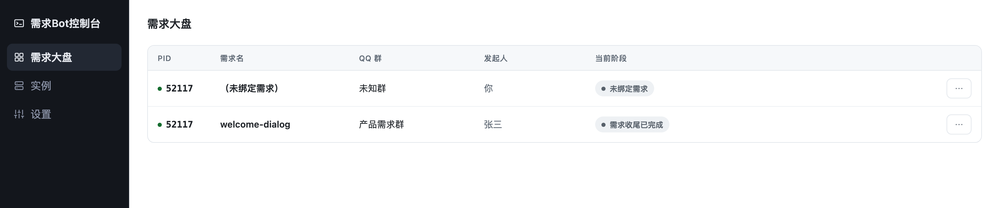
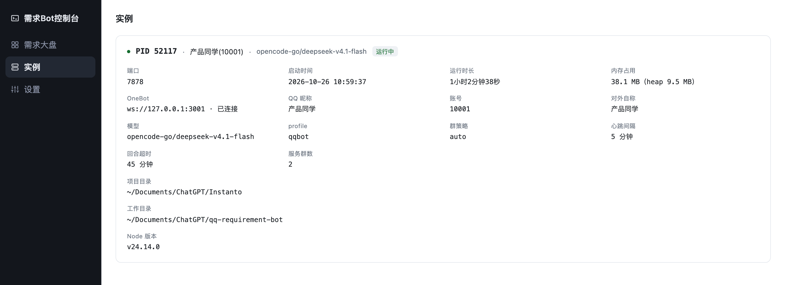
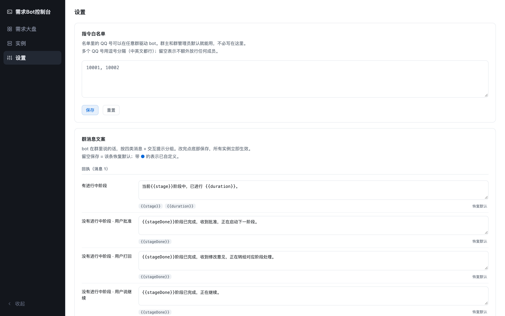

# 管理面板

> 返回 [README](../README.md)

常驻进程，聚合所有正在运行的 bridge 实例，看状态、下指令。

```bash
./start-panel.sh              # 默认 http://127.0.0.1:7879/console
./start-panel.sh 8899         # 换端口
```



左侧菜单三项：**需求大盘** / **实例** / **设置**。

**需求大盘**（默认）——每 3 秒轮询 `/api/board`，拿到的是**已经按群摊平**的表：
PID、需求名、QQ 群名、发起人、当前阶段状态徽章，每行末尾 `⋯` 菜单提供
**终止 / 重启 / 详细信息**。切到别的菜单会**自动停掉轮询**，切回来自动恢复。

**实例**——每个 bridge 进程一张卡，数据来自独立的 `/api/instances`（进程维度，
和大盘不共用接口）：PID、QQ 昵称与账号、模型、端口、启动时间、运行时长、
内存（RSS / heap）、OneBot 连接状态、profile、群策略、心跳间隔、回合超时、
服务群数、项目目录与工作目录。卡片左上角状态点变红表示该实例不可达。



**设置**——三块：



- **指令白名单**（可编辑）：填 QQ 号，中英文逗号均可分隔，保存时统一解析、校验、
  去重后写回 `bot.config.json`，并通知所有实例热更新（不用重启）。空值/多个逗号/
  换行都容忍；非法值（非数字、位数不对）会明确报错并拒绝保存。
- **群消息文案**（可编辑）：bot 在群里说的话，共 **40 条**，按「回执（消息 1）/
  阶段播报（消息 2）/ 其他 / 交互提示 / 指令与操作 / 系统通知」六组归类。
  每条独立编辑、独立恢复默认，只列自己可用的变量：
  `{{stage}}` `{{duration}}` `{{stageDone}}` `{{stageStarted}}` `{{reason}}`
  `{{content}}` `{{artifacts}}` `{{target}}` 等。校验拦：空模板、未知占位符、
  超过 2000 字符。留空保存 = 该条回默认。
- **超级管理员**（只读）：不受群角色与白名单限制，任何群都能驱动 bot——但突破的是
  「人」的限制，群本身若被 `excludeGroups` 排除或 `groupPolicy.mode=deny` 关闭，仍不服务。
  只能在 `bot.config.json` 的 `superAdmin` 字段里修改——面板不提供编辑入口，
  避免把自己锁在门外。

详细信息弹窗会显示该进程的完整状态：群 ID、当前模型、端口、发起时间、阶段进度、
当前回合（子进程是否存活、已运行多久）、最近 200 条日志。

## 架构

```
bridge（每个实例）
├── .instances/<pid>.json   启动时注册，退出时删除——面板靠它发现实例
└── 127.0.0.1:7878          /api/summary、/api/status、/api/logs、/api/ping、
                            /api/settings/apply、/api/groups/{stop,restart}

panel（一个进程）
├── 扫描 .instances/        发现所有实例
├── 拉 /api/summary         供大盘（群维度）与实例页（进程维度）各自取用
└── 127.0.0.1:7879          /console、/api/board、/api/instances、/api/settings，
                            以及转发到 bridge 的 /api/logs、/api/groups/{stop,restart}
```

面板与 bridge 分离：bridge 崩了面板还活着，能告诉你它崩了。

## API

所有接口只监听 `127.0.0.1`。

**鉴权边界**：面板自身不校验 token，只靠「仅监听回环地址」；`panel.token` 配了的话，
面板转发写操作到 bridge 时会带上 `x-panel-token`，由 bridge 校验来源。

### bridge（每个实例，7878）

| 接口 | 说明 |
| --- | --- |
| `GET /api/summary` | 精简状态：列表画得出的字段，不含事件流与阶段表 |
| `GET /api/status` | 完整状态：含阶段表与最近 50 条事件 |
| `GET /api/logs?n=100` | 最近日志，`n` 默认 100、上限 1000 |
| `GET /api/ping` | 存活探测，返回 pid |
| `POST /api/settings/apply` | 热更新配置（由面板调用） |
| `POST /api/groups/stop` | 终止该群当前回合 |
| `POST /api/groups/restart` | 掐断后用「继续」骨架重跑 |

写操作的参数都在 body 里，不出现在路径上：

```jsonc
// POST /api/groups/stop
{ "groupId": "476230759" }

// POST /api/groups/restart
{ "groupId": "476230759" }

// POST /api/settings/apply（面板改完配置后推过来，只带动过的字段）
{ "adminUsers": ["10001", "10002"] }
```

### panel（一个进程，7879）

| 接口 | 说明 |
| --- | --- |
| `GET /api/board` | 需求大盘：按群摊平的行 + 告警数 |
| `GET /api/board/detail?pid=&groupId=` | 大盘某一行的完整详情（群 + 它所在的进程） |
| `GET /api/instances` | 实例页：按进程维度的列表 |
| `GET /api/settings` | 读白名单与群消息文案 |
| `POST /api/settings/save` | 保存并热更新所有实例 |
| `GET /api/logs?pid=&n=200` | 先找到实例，再转发到它的 `/api/logs` |
| `POST /api/groups/stop` | 先找到持有该群的实例，再转发过去 |
| `POST /api/groups/restart` | 同上 |

保存配置只传要改的字段：

```jsonc
// POST /api/settings/save
{ "adminUsers": ["10001", "10002"] }
{ "messageTemplates": { "ack": "收到，开始处理。" } }
```

### 错误约定

失败统一返回 `{ "ok": false, "error": "人话" }`，状态码区分：

- **400** 参数问题：缺 `groupId`、JSON 不合法、白名单格式错、文案占位符未知
- **404** 找不到：详情里的 pid 已不在运行、未知路径
- **500** 服务端异常：读写配置文件失败等

**为什么按视图分开**：

- 需求大盘每 3 秒轮询，`/api/board` 只返回群维度、列表画得出的字段，连进程的
  `config` / `resources` 都不给
- 实例页只在切过去时拉一次 `/api/instances`，那边才需要进程级信息
- 详情挂在 `/api/board/detail` 而不是另起一个前缀——它本来就是「大盘某一行」
  展开（一个群 + 它所在的进程），返回里直接给 `group`，前端不用再从 `groups` 里翻

实机参考：两个群时 `/api/board` 约 660 字节，`/api/instances` 约 1.1 KB，
`/api/board/detail` 约 1.3 KB——之前大盘一个接口就把这些全带上。

## 日志

按天落盘到 `.logs/bridge-YYYY-MM-DD.log`，同时保留内存中最近 500 条供面板读取。
